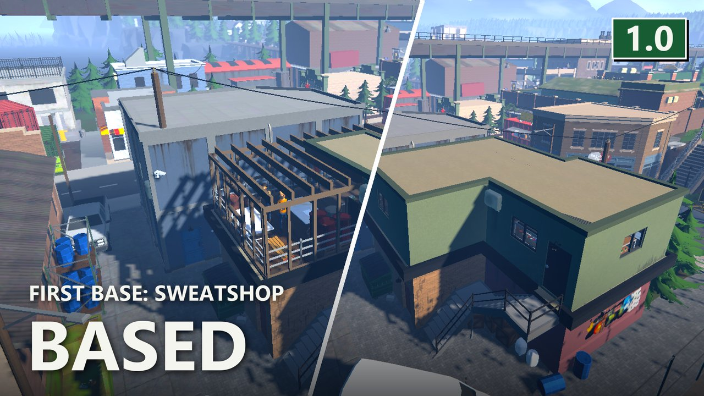
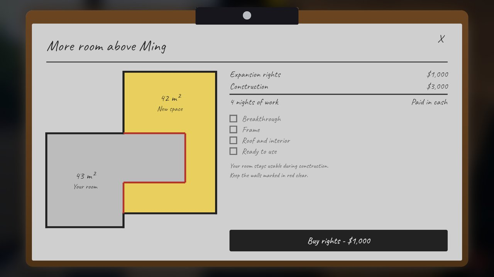
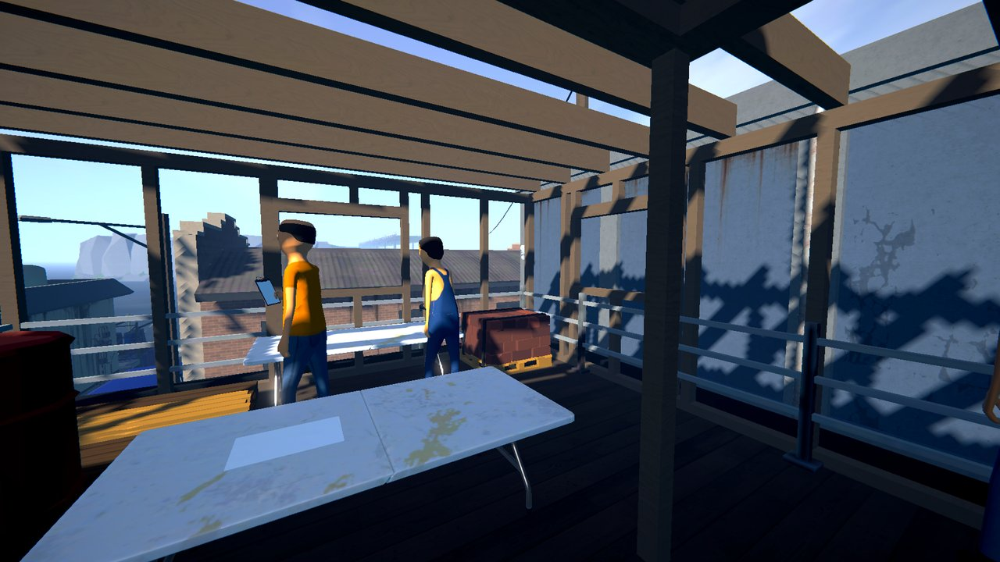
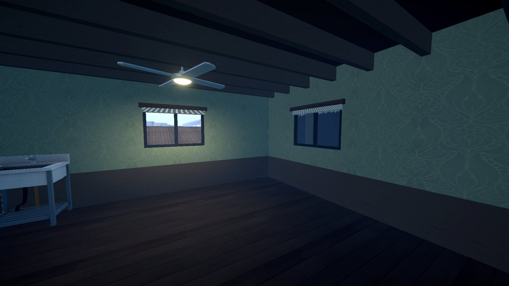
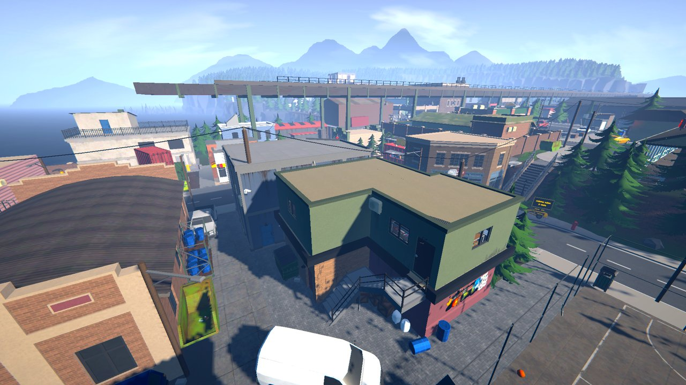
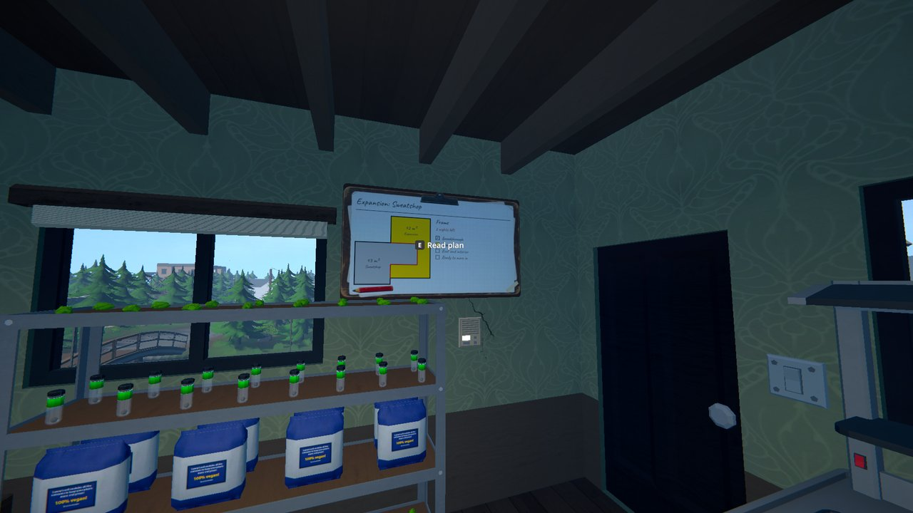

# Based

> 🛟 **Need help or found a bug?** Get support at [support.doodesch.de/based](https://support.doodesch.de/based).

**Download:** [Nexus Mods](https://www.nexusmods.com/schedule1/mods/3034) · [Thunderstore](https://thunderstore.io/c/schedule-i/p/DooDesch/Based/) · [GitHub Releases](https://github.com/DooDesch-Mods/ScheduleOne-Based/releases)

 

> Too little room in the Sweatshop? Buy the rest of the floor, order the work and watch a crew build it over four nights.

## What it does

Own the Sweatshop and ask Mrs. Ming to expand it. The plan opens as a clipboard with the floor plan.

1. **Buy the rights** for $1,000. This needs the Sweatshop itself first.
2. **Order the construction** for $3,000.
3. **Sleep.** Each night the crew gets one stage further: breakthrough, frame, roof and interior. A short notice
   each morning names the stage, and the journal lists the progress.
4. **Move in** on the fourth morning. The new space is part of the property: place stations and storage in it
   like in the old room, and hire 3 employees instead of 1.

You can keep using the room during construction. Keep the red walls clear, or the work goes on hold.

The rights come with a project folder. Left click it to read the plan, or hang it on a wall to follow the build.
Lost it? Ray at Ray's Realty sells a copy of the plans for $200.

## Loading dock

Once the expansion is done, the project folder offers the next stage: a loading dock in the yard behind the
restaurant, for $1,500 and one night of work. After that the Sweatshop shows up in the delivery app, and
employees can unload the van there.

## You pick the next base

The Sweatshop is the first base. The Discord votes on which property comes next:
[mods.doodesch.de](https://mods.doodesch.de).

## Co-op

Every player needs the mod and the same NPC packs. The host decides each purchase. Any player can pay, and the
money comes from the player who clicks.

## Removing the mod

Pick up what stands in the new rooms first. It disappears with the mod, and the Sweatshop keeps only its first employee.
Wait until no delivery is on its way to the Sweatshop, since the dock goes with the mod.

## Screenshots

| | |
|---|---|
|  |  |
|  |  |
|  | |

## Requirements

- [MelonLoader](https://melonwiki.xyz/) 0.7.3 or newer
- [S1API](https://thunderstore.io/c/schedule-i/p/ifBars/S1API_Forked/) 3.2.1 or newer
- [Personnel](https://www.nexusmods.com/schedule1/mods/2275) 2.4.6 or newer
- [Sideload](https://www.nexusmods.com/schedule1/mods/2360) 1.36.1 or newer
- [MapExpansions](https://www.nexusmods.com/schedule1/mods/3033) 1.2.0 or newer

## Installation

### Recommended: Nexus Mods

1. Install **MelonLoader 0.7.3** for Schedule I ([melonwiki.xyz](https://melonwiki.xyz/)).
2. Download Based from [Nexus Mods](https://www.nexusmods.com/schedule1/mods/3034) and install it with Vortex,
   or put **`Based.dll`** into your Schedule I `Mods/` folder.
3. Get the mods under Requirements from their Nexus pages the same way.

### Thunderstore mod manager

Install with a mod manager (r2modman / Gale) from the Schedule I community, or use the [Thunderstore page](https://thunderstore.io/c/schedule-i/p/DooDesch/Based/).

### Manual

Download the zip from [GitHub Releases](https://github.com/DooDesch-Mods/ScheduleOne-Based/releases) and put `Based.dll` into your Schedule I `Mods/` folder.

## Community

Join the DooDesch Mods Discord: update pings, polls on what comes next, and playtests of new mods.

## Credits

Built by DooDesch on [S1API](https://github.com/ifBars/S1API) by ifBars.

## License

DooDesch API License, see [LICENSE.md](LICENSE.md). Forks, changes and pull requests are welcome. Publishing or reuploading the mod or a changed copy needs written permission.

This mod is written with help from generative AI tools (Anthropic Claude, OpenAI Codex).
